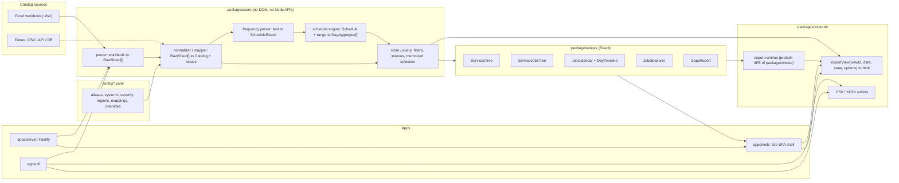
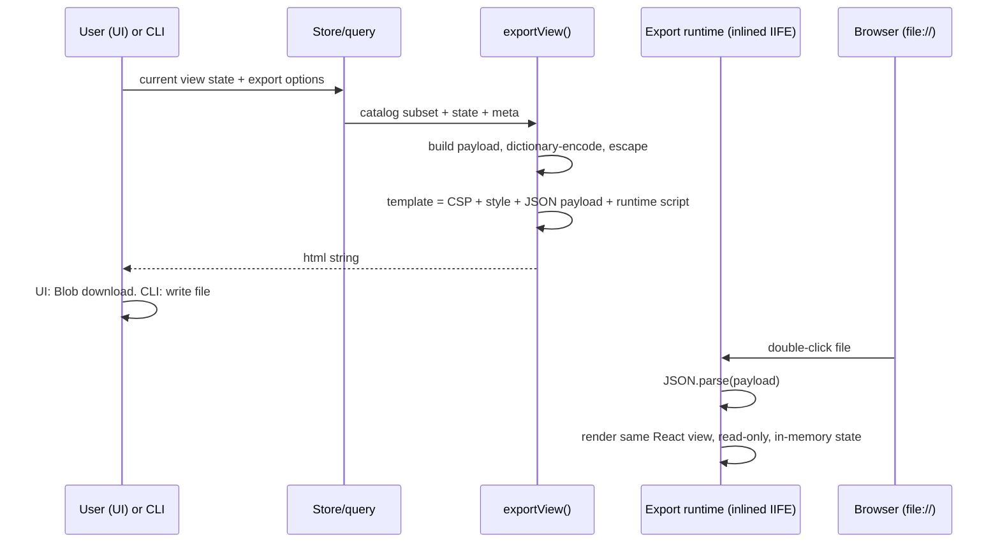
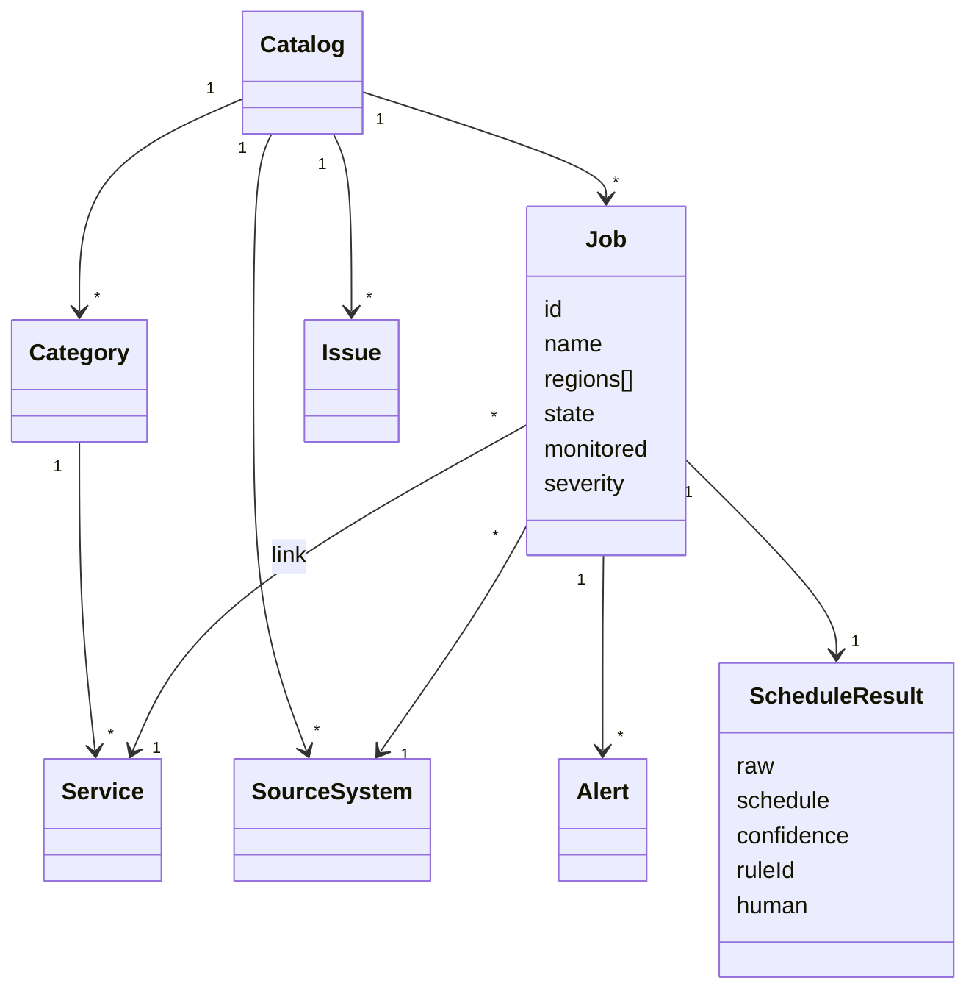

# Service–Job Catalog Viewer: Design

| | |
|---|---|
| Status | **Draft for review.** No code yet. |
| Date | 2026-10-29 |
| Input analysed | `raw-inputs/R+F Jobs Master List.xlsx` (read-only inspection) |
| Mockups | [`docs/mockups/index.html`](mockups/index.html): open by double-click, works offline. Shows **all 397 jobs and all 129 services** from the real workbook, generated by `scripts/build-mockup-data.mjs` (§6). |

---

## Contents

1. [Goals and non-goals](#1-goals-and-non-goals)
2. [What the real workbook looks like](#2-what-the-real-workbook-looks-like)
3. [Decisions confirmed](#3-decisions-confirmed)
4. [Stack decision and trade-offs](#4-stack-decision-and-trade-offs)
5. [Architecture](#5-architecture)
6. [Folder structure](#6-folder-structure)
7. [Domain model](#7-domain-model)
8. [Parsing rules](#8-parsing-rules)
9. [Service matching rules](#9-service-matching-rules)
10. [Frequency grammar and schedule model](#10-frequency-grammar-and-schedule-model)
11. [Schedule engine](#11-schedule-engine)
12. [Store, query and URL state](#12-store-query-and-url-state)
13. [UI design system](#13-ui-design-system)
14. [Views and wireframes](#14-views-and-wireframes)
15. [Static HTML export](#15-static-html-export)
16. [CLI](#16-cli)
17. [Local server and API](#17-local-server-and-api)
18. [Configuration files](#18-configuration-files)
19. [Testing strategy](#19-testing-strategy)
20. [Performance](#20-performance)
21. [Security and privacy](#21-security-and-privacy)
22. [Path to server deployment](#22-path-to-server-deployment)
23. [Setup on macOS and Windows](#23-setup-on-macos-and-windows)
24. [Milestones](#24-milestones)
25. [Risks and open items](#25-risks-and-open-items)
26. [Requirements traceability](#26-requirements-traceability)

---

## 1. Goals and non-goals

**Goals**
- Read the jobs workbook and build a typed, Excel-independent catalog of categories, services, source systems, jobs, alerts and schedules, plus data-quality issues.
- Provide five interactive views: the Business Services tree, the Service → Jobs tree, the monthly job calendar with day drill-down, the Jobs Explorer, and Gaps & Data Quality.
- Export every view as **one self-contained `.html` file** that works by double-click over `file://` with the network off.
- Run fully locally on macOS and Windows with one setup command and one start command. The design must allow a later move to a server without a rewrite.

**Non-goals (for now)**
- Editing the workbook itself. The app is read-only toward Excel and writes only its own config files.
- Live job status or monitoring integration. The catalog is descriptive, not real-time.
- Authentication and multi-user features. These are covered in the deployment path (§22) but not built.

---

## 2. What the real workbook looks like

A read-only inspection of the sample workbook found several things the brief didn't anticipate. Each one drives a design rule below.

### 2.1 Tabs

| Tab | Visible | Rows | Notes |
|---|---|---|---|
| Business Services | ✓ | 20 categories, 129 services | Category row = value in column A only. **No merges.** |
| Hybris_NOC | ✓ | 34 | **8 merged ranges** (A, B, D, G, H on rows 30–35). |
| Solr_NOC | ✓ | 6 | Extra `Alert Trigger` column. |
| SF Scheduled Jobs | ✓ | 9 | Region `All`. |
| Mulesoft Schedulers | ✓ | 84 | Extra `API Name` (col A) and `Duration`. **28 merged ranges**, e.g. `A5:A68`, `H5:H68`, `K5:K68`. |
| D&A - Airflow | ✓ | 110 | |
| D&A - DataFusion | ✓ | 86 | Extra columns after a blank gap: a duplicate `State` (`Active`) and **`Schedule interval` (real cron, e.g. `0 */1 * * *`)**. |
| D&A - RFCommission | ✓ | 49 | Named `RFCommission`, not `RFCommissions`. Informatica-style frequencies. |
| D&A - Scheduled Queries | ✓ | 19 | **Not in the brief.** Extra `State`, `Run Time`. Alerts separated by **commas**. |
| Global Services_NOC, BI_NOC, BigQuery_NOC, SF Report Jobs, D&A - Kafka Alerts | hidden | 5–98 | Older layout: `Frequency`, `Duration`, `Alert Trigger`, `Alert Name / Description`, no severity or owner columns. |
| Validation Lists | hidden | 20 | Data-validation lists and named ranges (`CategoryServiceMap`, `Svc_01…`). Not job data. |

### 2.2 Column contents (visible job tabs, 397 rows)

| Column | Observed |
|---|---|
| Severity, Resolution SLA, Alert Responder (L1), Alert Resolver (L2), Alert Frequency, Impacted User Group | **Empty in every row.** The UI must look good when these are blank and must flag them on the Gaps page. |
| State | `Enabled` (396), blank (1). DataFusion and Scheduled Queries also have a second `State` column with `Active`. |
| Monitored | `Yes` (389), `No` (7), blank (1), **after merged cells are expanded**. 63 of the cells look blank before expansion, because Mulesoft merges `H5:H68`. |
| Region | `US,CA,AU` (215), `Global` (62), `US, CA, AU` (49), `AU` (26), `US` (20), `All` (8), `CA` (6), `US & CA` (5), `US, CA` (2), `JP`, `Global (US/CA/JP/AU)`, `US, CA & AU`. |
| Service Category | 7 blank (after merges; 65 cells look blank before expansion). Values not in the master: `Solr`, `Supply Chain & Fulfillment`, `Consultant Compensation`, `Finance & Payments`, `Digital Commerce`, `Account Management`, `Marketing & Loyalty`, `Audit`, `Product Management`, `ECC`, `Inventory Management`, `Gigya`, `Penny`, `Customer & Consultant Data`, `Data Integration & Reporting`, `Platform Operations`, `Customer Data & Loyalty (GCP / BigQuery)`. Trailing space: `Autoship Management ` (11). |
| Business Service | 9 blank. Some use the category name (`Payments and Billing` ×31, `Customer Management` ×2), the Mulesoft taxonomy (`Warehouse & Logistics (3PL)` ×32), near-misses (`Data Protection ` vs master `Data Protection ,ETL Operations`), or `ALl`. |
| Alert Name | Newline-separated (Hybris, Solr) **or comma-separated** (Scheduled Queries). Sentinels meaning "no alert": `No alerts configured for this API`, `NA`. `Mail notification triggered for job failure.` (RFCommission) is treated as an e-mail alert, not a sentinel. |
| Job Frequency | About 150 distinct strings in about 15 families (see §10). 18 are `Triggers after successful run of X`. All are interpreted (0 unparseable): 326 parsed, 71 assumed, 9 with no schedule. |
| Schedule interval (DataFusion cron) | Present on every DataFusion row. **63 rows disagree with their Job Frequency text**: 47 say Manual / On Demand / Outbound / Triggers-after but carry a cron, and 16 give different times (e.g. `Every monday at 8:00 AM` vs cron `0 8 * * 2`, which is Tuesday). Listed on the Gaps page. |

### 2.3 Baseline matching on the real data (after merges, with the seeded suggestions of §9.4)

| Result | Jobs |
|---|---|
| Category exact + service exact | 212 |
| Matched after normalization (trailing or double spaces) | 11 |
| **Fully matched without any mapping** | **223 (56%)** |
| Placed on a service through a *suggested* mapping (needs confirmation) | 20 |
| Category matched (directly or by suggestion), service blank or unknown → "Unassigned service" | 133. Mostly the Mulesoft service taxonomy, e.g. `Warehouse & Logistics (3PL)` ×32, `Payments and Billing` ×31 |
| Category blank or unknown → "Unmapped" | 21. `Solr` ×6, `Data Integration & Reporting` ×2, `Audit`, `ECC`, `Penny`, … |

There are 50 distinct values that need a mapping decision. The mapping helper (§14.7) lists each one with the number of jobs it affects. Once the 12 seeded suggestions are confirmed, 243 jobs (61%) sit on a real service. The rest need either new mappings or new services in the master tab.

---

## 3. Decisions confirmed

| Topic | Decision |
|---|---|
| Schedule timezone | **All frequency times are America/Los_Angeles (Pacific).** `scheduleTimezone` is global config and can be overridden per tab. The display timezone is selectable in the UI (default Pacific). |
| Severity scale | **Sev1 / Sev2 / Sev3 / Unknown**, with an alias map (`P1`, `S1`, `Sev 1`, `Critical`…). Each level has a colour, an icon and a text label. |
| Hidden tabs | Skipped by default (`includeHiddenTabs: false`, plus a per-tab allowlist). The parse report lists the skipped tabs. |
| Architecture | **Thin local Fastify server plus a shared, isomorphic TypeScript core.** |
| Regions | **One row = one job, as written in the sheet.** The region cell becomes `regions[]` for filtering. `Global`/`All` expand to every configured region. Separate rows for AU and CA are separate jobs. |
| Service mappings | Ship `config/service-mappings.yaml` with suggestions marked `status: suggested`. You confirm them in the UI or in the file. |
| Triggered jobs | `Triggers after successful run of X`: resolve X and inherit its schedule (confidence `assumed`). If X can't be resolved, the job is Unscheduled. Manual / Not Scheduled / On Demand / Outbound jobs are always Unscheduled. |

---

## 4. Stack decision and trade-offs

### 4.1 Summary

| Concern | Choice | Why |
|---|---|---|
| Runtime | **Node 22 LTS** | Current LTS. Full ICU by default, so timezones work offline in Node and browsers. |
| Language and tooling | **TypeScript (strict)**, ESLint flat config + typescript-eslint (strict-type-checked), Prettier | Matches your preference and the quality bar. |
| Repo layout | **npm workspaces** | No extra tool to install on Windows. Gives clear package boundaries between the layers. |
| UI | **React 19 + Vite** | Your preference. The same components render in the app and in the export runtime. |
| Workbook parsing | **SheetJS (`xlsx`), pinned official tarball** | Reads merges (`!merges`), hidden-sheet state (`Workbook.Sheets[i].Hidden`) and rich text. Works in Node and the browser. The npm-registry `xlsx` package is stale, so it's installed from the official SheetJS tarball and pinned in `package-lock.json`. |
| Trees | **d3-hierarchy + d3-zoom**, nodes rendered by React | Small, layout-only, prints well. Custom compact org-chart layout (§14.3). |
| Calendar | **Custom month grid + SVG day timeline** | Full control of load shading and markers. No premium licence needed. |
| Schedules | **Own frequency parser + schedule engine** | Free-text grammar is domain-specific. Per-day aggregation can be computed without iterating occurrences. |
| Dates and timezones | **date-fns v4 + `@date-fns/tz`** | Uses `Intl`, so no tz database to bundle. Tree-shakable. |
| Table | **TanStack Table + TanStack Virtual** | Headless, works with 10k rows virtualized. |
| UI state | **Zustand**, with views receiving state through props | Tiny. The same store shape serves the app and exports. |
| Validation | **zod** | One schema for config files, URL state and export payloads. |
| Icons and fonts | **lucide-react** (tree-shaken inline SVG) and the **system font stack** | Nothing to fetch, and no font files to inline. |
| Server | **Fastify 5** + `@fastify/static` + chokidar | Thin local backend (§17). Also the future server. |
| Tests | **Vitest** (unit), **Playwright** (app + export E2E), `@axe-core/playwright` (a11y) | |

### 4.2 Trees: D3 hierarchy vs React Flow + ELK/dagre

| | d3-hierarchy + d3-zoom (**chosen**) | React Flow + ELK | React Flow + dagre |
|---|---|---|---|
| Bundle (minified) | ~35 KB | ~150 KB + **elkjs ~1.4 MB** | ~150 KB + ~40 KB |
| `file://` single-file | ✓ | ⚠ elkjs prefers a Web Worker from a URL, which fails on `file://`; the bundled sync build works but is huge | ✓ |
| Wrapping children into rows/columns | Custom layout on top of `hierarchy()`, ~150 LOC | Possible via ELK options, hard to tune | Not supported |
| Print | Plain DOM/SVG, prints cleanly | Canvas-like viewport, prints poorly | Same |
| Editing and drag | Not needed | Its main strength | Its main strength |

React Flow's strength is editable graphs, which we don't need. A layout-only library plus our own React nodes is lighter and prints better.

### 4.3 Calendar: FullCalendar vs custom grid

| | Custom grid (**chosen**) | FullCalendar |
|---|---|---|
| Month grid | Simple CSS grid | ✓ |
| Day timeline grouped by system | Custom SVG swimlanes | Needs **Resource Timeline, a premium (paid) plugin** |
| Per-day aggregation (×288 badge, top N, load shade) | Native to our model | Fights the event model: 288 events per job per day, or custom rendering |
| Size | ~10 KB of our code | ~250 KB |
| `file://` | ✓ | ✓ |

### 4.4 Schedules: cron library vs own parser

`cron-parser` iterates occurrences one at a time. A month for 10k jobs at up to 288 runs a day is about 86 M iterations, which is far too slow for the browser. Our engine stores cron-like **sets** (minutes, hours, days, months, weekdays), so a day's run count is `|hours| × |minutes|` when the day matches. Exact times are listed only for the one day being drilled into. `cron-parser` stays a **dev dependency** for differential tests: for every 5-field cron in the fixtures, our engine's occurrences must equal cron-parser's.

### 4.5 Client-side parsing vs thin local backend

| | Pure client SPA | **Thin local Fastify + shared core (chosen)** |
|---|---|---|
| Remember last workbook path and reload | Chrome/Edge only (File System Access API). Not Safari or Firefox. | ✓ any browser. The server reads the path. |
| Watch the workbook for changes | ✗ | ✓ chokidar, then server-sent events (SSE) to the browser |
| Save mapping and override files from the UI | Download a file and copy it into `config/` yourself | ✓ validated, atomic write to `config/` |
| Read config files | Must be bundled or uploaded | ✓ read from disk at runtime |
| Server deployment later | Static host plus a separate batch tool | **Same process**, with auth and a reverse proxy added |
| Extra moving parts locally | None | One Node process, started by `npm start` |

The core (parser, normalizer, schedule engine, exporter) has **no Node or DOM dependencies**, so it also runs in the browser (drag-drop preview, export generation) and in the CLI.

### 4.6 `file://` compatibility of every runtime dependency

| Library or technique | Used in export runtime | Works inlined on `file://` | Notes |
|---|---|---|---|
| React 19, react-dom | ✓ | ✓ | |
| d3-hierarchy, d3-zoom, d3-selection | ✓ | ✓ | |
| date-fns, @date-fns/tz | ✓ | ✓ | Uses the browser's `Intl` tz data |
| TanStack Table, TanStack Virtual | ✓ | ✓ | |
| Zustand, zod | ✓ | ✓ | |
| lucide-react | ✓ | ✓ | Inline SVG |
| SheetJS | ✗ (app/CLI only) | ✓ | Excluded from exports to save ~400 KB |
| Fastify, chokidar | ✗ | n/a | Server only |
| **elkjs (worker build)** | ✗ | ✗ | Worker loaded from a URL |
| **FullCalendar Resource Timeline** | ✗ | ✓ but paid | Premium licence |
| **Dynamic `import()` / lazy chunks** | ✗ | ✗ | Disabled in the export build (`inlineDynamicImports`) |
| **`<script type="module" src>`** | ✗ | ✗ | Chrome blocks it on `file://` (null origin). Export uses a classic inline script. |
| **`fetch()` of JSON** | ✗ | ✗ | Data is inlined as a JSON `<script>` block |
| **Web Workers from URL** | ✗ | ✗ | Not needed. The engine is fast enough on the main thread. |
| **Web fonts** | ✗ | n/a | System font stack |

---

## 5. Architecture

### 5.1 Layers



### 5.2 Export flow (same function from the UI and the CLI)



### 5.3 Package dependency rules

- `core` depends on nothing internal. **No React, DOM, `fs` or SheetJS in the domain model.** SheetJS is used only in `core/parser/xlsx`, behind the `CatalogSource` interface, so other sources plug in.
- `views` depends on `core` (types and query) only.
- `exporter` depends on `core` and on the *built* runtime asset of `views`.
- `apps/*` depend on any package. Packages never depend on apps.
- An ESLint rule (`import/no-restricted-paths`) enforces these boundaries.

---

## 6. Folder structure

```
rf-monitoring/
├─ package.json                # npm workspaces + cross-platform scripts
├─ tsconfig.base.json
├─ eslint.config.js  .prettierrc
├─ playwright.config.ts  vitest.workspace.ts
├─ .gitignore                  # raw-inputs/, data/*.xlsx, exports/, .local/, node_modules/, dist/,
│                              # docs/mockups/assets/catalog-data.js (generated from real data)
├─ CLAUDE.md                   # project conventions (created after design approval)
├─ README.md
├─ config/                     # all behaviour that varies by data (§18)
│  ├─ app.yaml
│  ├─ header-aliases.yaml
│  ├─ systems.yaml
│  ├─ severity.yaml
│  ├─ regions.yaml
│  ├─ service-mappings.yaml
│  └─ schedule-overrides.yaml
├─ raw-inputs/                 # your real workbook (gitignored)
├─ data/                       # other workbooks (*.xlsx gitignored)
├─ exports/                    # CLI output (gitignored)
├─ .local/                     # per-machine settings, e.g. last workbook path (gitignored)
├─ docs/
│  ├─ DESIGN.md
│  └─ mockups/                 # clickable static mockups (§13, §14)
├─ packages/
│  ├─ core/src/
│  │  ├─ domain/               # types: Catalog, Category, Service, Job, Alert, SourceSystem, Schedule, Issue
│  │  ├─ config/               # zod schemas + loaders (pure: take parsed objects)
│  │  ├─ parser/               # CatalogSource interface; xlsx/ adapter (SheetJS): RawSheet[]
│  │  ├─ normalizer/           # header matching, tab detection, cell cleaning, region/state/severity, alerts
│  │  ├─ mapper/               # service matching + mapping suggestions
│  │  ├─ schedule/
│  │  │  ├─ grammar/           # one file per rule family + registry
│  │  │  ├─ model.ts           # Schedule types
│  │  │  └─ engine.ts          # occurrences, DayAggregate, tz/DST
│  │  ├─ query/                # filters, indexes, selectors, view-state schemas
│  │  └─ report/               # parse report + gaps analysis
│  ├─ views/src/
│  │  ├─ theme/tokens.css      # design tokens (same file the mockups use)
│  │  ├─ components/           # SeverityBadge, SystemChip, JobTile, DetailDrawer, FilterBar, …
│  │  ├─ services-tree/  service-jobs-tree/  calendar/  explorer/  gaps/
│  │  ├─ layout/               # compact org-chart layout on d3-hierarchy
│  │  └─ export-runtime.tsx    # entry for the IIFE export bundle
│  └─ exporter/src/
│     ├─ exportView.ts         # pure: (viewId, data, state, options) to string
│     ├─ payload.ts            # subset + dictionary encoding
│     ├─ template.ts           # HTML shell, CSP, escaping
│     ├─ filename.ts
│     ├─ csv.ts  xlsx.ts
│     └─ generated/runtime.ts  # built runtime JS/CSS + CSP hash (generated, not hand-edited)
├─ apps/
│  ├─ web/                     # Vite SPA: router, URL state, Load page, mapping helper, export dialog
│  ├─ server/                  # Fastify: static app, /api/*, file watch
│  └─ cli/                     # report | export | export --all
├─ scripts/                    # Node .mjs only (start, build-runtime, clean): no bash
│  └─ build-mockup-data.mjs    # prototype of the M1 pipeline; writes docs/mockups/assets/catalog-data.js
└─ tests/
   ├─ fixtures/
   │  ├─ build-fixture.ts      # generates synthetic-catalog.xlsx with SheetJS
   │  └─ synthetic-catalog.xlsx
   └─ e2e/
      ├─ app/*.spec.ts
      └─ export/*.spec.ts
```

Unit tests sit next to their source as `*.test.ts`.

---

## 7. Domain model

The model has no knowledge of Excel. Every field that came from a cell keeps its **raw** value next to its normalized value, so the UI can always show what the sheet said.

```ts
// packages/core/src/domain/types.ts
export interface Catalog {
  source: SourceInfo;            // file name, modified date, loaded at, source kind
  categories: Category[];        // master order, plus synthetic "Unmapped"
  services: Service[];           // master order, plus synthetic "Unassigned service" per category
  systems: SourceSystem[];
  jobs: Job[];
  issues: Issue[];               // validation / data-quality findings
}

export interface Category {
  id: string;                    // slug of normalized name
  name: string;                  // raw display value from master
  order: number;
  synthetic?: 'unmapped';
}

export interface Service {
  id: string;
  categoryId: string;
  name: string;
  description: string;
  order: number;
  synthetic?: 'unassigned';
}

export interface SourceSystem {
  id: string;                    // e.g. "bi-airflow"
  tabName: string;               // "D&A - Airflow"
  displayName: string;           // "BI / D&A"
  subsystem?: string;            // "Airflow"
  color: string;                 // token name or hex from systems.yaml
  glyph: string;                 // 2-letter monogram, a non-colour cue
  hidden: boolean;
}

export type SeverityLevel = 'Sev1' | 'Sev2' | 'Sev3' | 'Unknown';
export type JobState = 'Enabled' | 'Disabled' | 'Unknown';
export type LinkStatus = 'exact' | 'normalized' | 'mapped' | 'suggested' | 'inferred' | 'unmatched';

export interface ServiceLink {
  categoryRaw: string | null;
  serviceRaw: string | null;
  categoryId: string;            // real id, or "unmapped"
  serviceId: string;             // real id, or "<categoryId>/unassigned"
  categoryStatus: LinkStatus;
  serviceStatus: LinkStatus;
  status: LinkStatus;            // the weaker of the two
  mappingRuleId?: string;
}

export interface Alert {
  name: string;                  // raw, trimmed
  key: string;                   // normalized: casefold, strip _ - and spaces ("_Not_Finished" equals "_NotFinished")
  kind?: 'Failed' | 'NotFinished' | 'NotStarted' | 'Error' | 'Other';
}

export interface Job {
  id: string;                    // stable: hash(systemId, normalized name, raw region, dupIndex)
  systemId: string;
  name: string;
  description: string | null;
  regions: string[];             // ["US","CA","AU"]
  regionRaw: string | null;
  state: JobState;               stateRaw: string | null;
  monitored: boolean | null;     monitoredRaw: string | null;
  link: ServiceLink;
  alerts: Alert[];               alertsRaw: string | null;
  alertFrequency: string | null;
  severity: SeverityLevel;       severityRaw: string | null;
  resolutionSla: string | null;
  l1Team: string | null;
  l2Team: string | null;
  stakeholder: string | null;
  systemImpact: string | null;
  businessImpact: string | null;
  impactedUserGroup: string | null;
  schedule: ScheduleResult;      // §10
  attributes: Record<string, string>;   // unknown/extra columns, e.g. "API Name", "Duration", "Schedule interval"
  provenance: { sheet: string; row: number };
}

export interface Issue {
  code: IssueCode;               // e.g. 'HEADER_UNKNOWN', 'CATEGORY_UNMATCHED', 'FREQ_UNPARSEABLE'
  level: 'info' | 'warning' | 'error';
  message: string;
  sheet?: string; row?: number; column?: string;
  jobId?: string;
}
```



---

## 8. Parsing rules

### 8.1 Pipeline

`CatalogSource.read()` → `RawSheet[]` (`{ name, hidden, rows: (string|null)[][], merges }`) → **expand merges** → **detect sheet role** → **match headers** → **clean cells** → **map rows to domain**.

### 8.2 Cell cleaning (applied to every value)

- Convert to string. Numbers keep their displayed text (SheetJS `w`), so `6:05` isn't turned into `0.2534`.
- Normalize `\r\n` and `\r` to `\n`, and non-breaking spaces to spaces.
- **Display value** = trimmed, with internal newlines kept (alerts) and runs of spaces kept as they are (the raw value is shown as-is).
- **Match key** = `trim → collapse whitespace → NFKC → casefold`. It's used only for comparison, never shown.
- Empty after trim → `null`.

### 8.3 Merged cells

SheetJS returns `!merges`. For **every** sheet, the top-left value is copied into every cell of each merged range before any other processing. This is required for Hybris_NOC and Mulesoft Schedulers. The master sheet doesn't rely on merges (it has none). Its category is forward-filled by rule (§8.5).

Blank cells that are **not** merged are **never** forward-filled in job tabs. A blank category there is real missing data and goes to Unmapped.

### 8.4 Sheet role detection (no hard-coded tab list)

The header row is the first row (within the first 10) that has at least 3 non-empty cells. Each header cell is matched to a canonical field (§8.6), and the score decides the role:

| Role | Rule (configurable in `app.yaml → sheetDetection`) |
|---|---|
| `master` | Headers include `serviceCategory`, `businessService` and `description`, and do **not** include `jobName`. |
| `jobs` | Headers include `jobName` **and** (`jobFrequency` or `frequency`) **and** at least one of `state`, `monitored`, `serviceCategory`. |
| `ignored` | Anything else (e.g. Validation Lists). Reported as "skipped (not recognised)". |

Hidden sheets are skipped before scoring unless `includeHiddenTabs: true` or the tab is in `tabAllowlist`. They're reported as "skipped (hidden)".

### 8.5 Master tab rules

- A **category row** has a non-empty category and empty service and description cells.
- A **service row** has an empty category and a non-empty service. It belongs to the most recent category row (forward fill).
- A row with both category and service filled is treated as a service under that category, and the category becomes current.
- Rows before the first category, and other odd rows, become `MASTER_ORPHAN_ROW` warnings.
- Duplicate service names in the same category become a `MASTER_DUPLICATE_SERVICE` warning. The first one wins.

### 8.6 Header matching

1. **Header key** = lowercase, remove everything that isn't a letter or digit. For example, `"State \r\n(Enabled / Disabled) "` → `stateenableddisabled`.
2. Look the key up in `header-aliases.yaml`, which lists canonical fields with their exact keys and optional prefixes. For example, `state` has the alias `state` and the prefix `stateenabled`.
3. The **first** column that matches a canonical field wins. A later duplicate (e.g. DataFusion's second `State`) goes to `attributes` as `"State (col W)"`.
4. Unrecognised headers go to `attributes` under their trimmed display text (`API Name`, `Duration`, `Schedule interval`, `Run Time`, `Alert Trigger`).
5. Columns with a blank header but data become `"Column X"` attributes plus an info issue.
6. A tab missing any of the required fields gets a `HEADER_MISSING` warning. The fields are still read as `null`.

### 8.7 Field normalization

| Field | Rule |
|---|---|
| Region | Split on `,` `&` `/` `;` ` and ` and parentheses → uppercase tokens → `regions.yaml` aliases (`GLOBAL`, `ALL` → all configured regions). Unknown tokens are kept with a `REGION_UNKNOWN` info issue. A blank cell is `[]` and matches only "Region: (none)". |
| State | `regions.yaml`-style alias map in `app.yaml`: Enabled/Active/On → `Enabled`. Disabled/Inactive/Paused/Off → `Disabled`. Blank → `Unknown`. |
| Monitored | Yes/Y/True/Enabled → `true`. No/N/False → `false`. Blank → `null` (shown as "Unknown"). |
| Severity | `severity.yaml` aliases → `Sev1`/`Sev2`/`Sev3`. Blank or unknown → `Unknown`, with `severityRaw` kept. |
| Alerts | Split on newline **and** comma (configurable separators), trim, drop empties. Values in the `noAlertSentinels` list (e.g. `No alerts configured for this API`, `NA`) mean "no alerts", and the raw text shows in the drawer. Alert `kind` comes from suffix patterns (`_Failed`, `_NotFinished`/`_Not_Finished`, `_NotStarted`, `_Error`). |
| Job name | Display = trimmed raw. Rows with a blank job name but other data → `JOB_NAME_MISSING` warning and the row is **kept** as `(unnamed row 37)`. |
| Empty rows | Rows where every cell is blank are skipped silently. |

---

## 9. Service matching rules

### 9.1 Algorithm (per job)

```
categoryRaw, serviceRaw ← row
1. Category
   a. exact (raw === master.name)                → exact
   b. matchKey equal                             → normalized
   c. service-mappings.yaml category rule        → mapped | suggested
   d. (deferred until service step) inference    → inferred
   e. otherwise                                  → unmatched
2. Service (searched within the resolved category, else globally)
   a. exact                                      → exact
   b. matchKey equal                             → normalized
   c. mapping rule (scoped "Category / Service" first, then global service rule) → mapped | suggested
   d. if category unmatched AND the service matchKey is unique across the master
        → service inferred; category inferred from it
   e. otherwise                                  → unmatched
3. Placement
   - category resolved, service resolved     → that service
   - category resolved, service blank/unmatched → "<Category> / Unassigned service"
   - category unmatched or blank             → "Unmapped / <categoryRaw or (blank)>"
4. link.status = weaker of (categoryStatus, serviceStatus)
   order: exact > normalized > mapped > inferred > suggested > unmatched
```

### 9.2 What every view does with each status

| Status | Placement | Visual cue |
|---|---|---|
| exact | under the service | none |
| normalized | under the service | none in tiles; shown in the drawer ("matched after normalizing") |
| mapped | under the service | small "mapped" tag in the drawer, with a link to the rule |
| inferred | under the service | "inferred" tag in the drawer |
| suggested | under the service | dotted "suggested" tag on the tile; listed on the Gaps page until confirmed |
| unmatched | **Unassigned service** (category known) or **Unmapped** (category unknown) | dashed node border and a warning icon |

**Unmapped and Unassigned nodes appear in every view and every export, are never hidden by default, and are counted in every total.** View 2 has a "Show unmapped jobs" toggle, which defaults to on. The Gaps page always lists them.

### 9.3 Mapping file

```yaml
# config/service-mappings.yaml
version: 1
categories:
  - from: "Account Management"
    to: "Customer Management"
    status: suggested            # suggested | confirmed | rejected
  - from: "Supply Chain & Fulfillment"
    to: "Fulfillment and Shipping"
    status: suggested
services:
  - from: "Customer Profile"
    to: { category: "Customer Management", service: "Profile and Account Maintenance" }
    status: suggested
  - from: "Payments and Billing"            # service named after its category
    within: "Payments and Billing"          # optional: only when job category matches this
    to: { category: "Payments and Billing", service: "Billing and Invoice Management" }
    status: suggested
```

- `rejected` entries keep the job unmatched and stop the UI from suggesting the same mapping again.
- The **mapping helper** on the Gaps page lists every distinct unmatched raw value, the number of jobs affected, and a ranked suggestion: token-overlap (Jaccard) on match keys plus a synonym list (`&` ↔ `and`, `Mgmt` ↔ `Management`). You can confirm, change (searchable picker over the master) or reject each one. The server saves the file atomically, keeping a `.bak`.

### 9.4 Seeded suggestions (shipped with M1, all `status: suggested`)

| Raw value in job tabs | Suggested target |
|---|---|
| Category `Account Management` | Customer Management |
| Category `Autoship Management ` (trailing space) | handled by normalization, no rule needed |
| Category `Supply Chain & Fulfillment`, `Inventory Management` | Fulfillment and Shipping |
| Category `Finance & Payments` | Payments and Billing |
| Category `Consultant Compensation` | Commissions and Incentives |
| Category `Product Management`, `Digital Commerce` (catalog jobs) | Product and Catalog Management |
| Category `Marketing & Loyalty` | Loyalty and Rewards |
| Category `Gigya` | Identity and Access Management |
| Service `Customer Profile` | Customer Management / Profile and Account Maintenance |
| Service `Data Protection ` | Backups and Maintenance / Data Protection ,ETL Operations |
| Service `Login & Authentication` | Identity and Access Management / Login and Authentication |
| `Audit`, `ECC`, `Solr`, `Penny`, `Platform Operations`, `Data Integration & Reporting` | **no suggestion.** These look like systems or new categories. Decide in the helper, either a new mapping or a request to add them to the master tab. |

---

## 10. Frequency grammar and schedule model

### 10.1 Schedule model

```ts
// packages/core/src/schedule/model.ts
export type Schedule =
  | { kind: 'calendar'; tz: string; rules: CalendarRule[] }        // cron-like sets (union of rules)
  | { kind: 'interval'; tz: string; everySeconds: number;            // fixed cadence that doesn't align to the clock
      anchor: 'midnight' | { at: string }; daysOfWeek?: number[] }
  | { kind: 'dependent'; upstreamName: string; upstreamJobId?: string; offsetMinutes: number }
  | { kind: 'none'; reason: 'manual' | 'on-demand' | 'not-scheduled' | 'event' | 'blank' | 'unknown' };

export interface CalendarRule {         // undefined field = "every"
  seconds?: number[];                   // default [0]
  minutes: number[];                    // 0–59
  hours: number[];                      // 0–23
  daysOfMonth?: number[];               // 1–31
  months?: number[];                    // 1–12
  daysOfWeek?: number[];                // 0=Sun … 6=Sat
  nthWeekday?: { weekday: number; nth: 1 | 2 | 3 | 4 | 5 | -1 };
  dayStep?: { every: number; anchor: string };  // every N days from ISO anchor date
}

export type Confidence = 'parsed' | 'assumed' | 'unparseable';

export interface ScheduleResult {
  raw: string | null;          // exact cell text
  source: 'frequency' | 'cronColumn' | 'override';
  schedule: Schedule;
  confidence: Confidence;
  assumptions: string[];       // e.g. ["time not given; assumed 00:00"]
  ruleId: string;              // grammar rule that matched, e.g. "runs-at"
  human: string;               // "Every 15 min from :05"
  isDaily: boolean;            // runs every day: used by "only non-daily" toggle
}
```

**Confidence**
- `parsed`: the text fully determines the schedule.
- `assumed`: a schedule was derived, but something was defaulted (time of day, anchor, weekday, or inherited from an upstream job). Every assumption is listed in `assumptions[]` and shown in the drawer. The calendar draws assumed runs with a dashed or hatched marker.
- `unparseable`: no rule matched. The job goes to **Unscheduled / Unknown frequency** with the raw text. Jobs with `kind: 'none'` (manual, on demand…) also go to that list, with their reason, but count as `parsed`, because "Manual" is a known answer.

### 10.2 Resolution order for each job

1. **Override** in `schedule-overrides.yaml` (by job selector) → `source: override`.
2. **Cron column**, if the tab config names one (`cronColumns: ["Schedule interval"]` for D&A - DataFusion) and it holds a valid 5- or 6-field cron. It wins when the frequency text is vague ("Outbound to semantic table", "Every 1 hr"). If both are precise and disagree, the cron wins and a `FREQ_CONFLICT` info issue is raised.
3. **Frequency text** through the grammar registry.
4. Dependents are resolved last, in a second pass (§10.5).

### 10.3 Grammar: ordered rule registry

Each rule lives in its own file: `match(text) → ScheduleResult | null`. Text is pre-normalized (lowercase, trim, collapse spaces, strip a leading newline, `1 :00` → `1:00`, `hrs` → `hours`, `mins` → `minutes`). The first match wins, so the order matters. The table below covers **every frequency family found in the real workbook**, plus the brief's examples.

| # | Rule id | Pattern (simplified) | Examples (from the brief or the real data) | Result | Confidence |
|---|---|---|---|---|---|
| 1 | `none` | manual · on demand · not scheduled · outbound · na · blank | `Manual`, `On Demand`, `Not Scheduled`, `Outbound ` | `none` with reason | parsed |
| 2 | `dependent` | `triggers after successful run of <name>[ dag]` | `Triggers after successful run of feed_account` | `dependent` | assumed (once resolved) |
| 3 | `cron` | 5/6 fields of `[\d*/,-]` | `0 */1 * * *` | calendar | parsed |
| 4 | `runs-at` | `runs at <H[,H…]>:<MM[,MM…]>[ (day *, weekday a-b)]` · hours list before the colon, minutes list after | `Runs at 6:05` → 06:05 · `Runs at 16:10` · `Runs at 16:15,30,45,59` → 16:15/30/45/59 · `Runs at 20,0:05` → 20:05 + 00:05 · `Runs at 4,8:05` · `Runs at 18:30 (day *, weekday 1-5)` → Mon–Fri | calendar | parsed |
| 5 | `every-n-minutes` | `every (n )?min(ute)?s?[ starting at minute s][ (list)]` | `Every 5 minutes` → :00/:05/… · `Every 10 minutes starting at minute 5` → :05/:15/… · `Every 15 minutes starting at minute 5` · `Every minute` · `Every 5 min` · `Every 15 minutes (0,15,30,45)` | calendar when 60 % n = 0; otherwise `interval` (`Every 7 minutes`) | parsed (interval: assumed, aligned to midnight) |
| 6 | `every-n-seconds` | `every n seconds` | `Every 300 seconds` → every 5 min · `Every 500 seconds` | calendar if it divides 3600, else `interval` | parsed / assumed |
| 7 | `hourly-at` | `hourly at :mm` · `hourly, at m minutes past the hour` · `every hour, starting at midnight …` | `Hourly at :40` · `Hourly, at 5 minutes past the hour` | calendar | parsed |
| 8 | `cronstrue` | `at m minutes past the hour, every n hours[, starting at hh:mm am][, between …]` (the English that cronstrue generates from cron) | `At 30 minutes past the hour, every 6 hours, starting at 07:00 AM` → 07:30/13:30/19:30/01:30 · `At 0 minutes past the hour, every 2 hours, between 04:00 PM and 10:59 PM and every 2 hours, between 12:00 AM and 02:59 AM` → 16,18,20,22,0,2 | calendar | parsed |
| 9 | `at-time` | `(daily\|everyday\|every day )?at hh[:mm] [am\|pm][ (midnight)]` + optional qualifiers: `, monday through friday` · `, only on monday` · `, on day 1 of the month` · `, between day 04 and 15 of the month` · `, on day 10 through 15 and 25 through 28 of the month` · `, every 7 days` (cronstrue for dom `*/7`) | `At 11:00 PM` · `Daily at 12:05 PM` · `Everyday  at 8 AM` · `Everyday at 11PM` · `Daily at 12:00 AM (midnight)` · `At 03:30 PM, Monday through Friday` · `At 12:00 PM, on day 10 through 15 and 25 through 28 of the month` | calendar | parsed |
| 10 | `twice-daily` | `twice daily at t1 and t2` | `Twice daily at 6:00 AM and 6:00 PM` | calendar | parsed |
| 11 | `weekly` | `every <weekday> at t` | `Every monday at 8:00 AM` | calendar | parsed |
| 12 | `monthly` | `monthly on the nth day at t` · `nth day of the month at t` | `Monthly on the 6th day at 1:00 AM` · `1st day of the month at 1 :00 AM` | calendar | parsed |
| 13 | `nth-weekday` | `h:mm[:ss] am on the nth <weekday> of <months>` | `3:49:20 AM on the 3rd Thursday of February, June, and October` | calendar (`nthWeekday`, `months`, `seconds`) | parsed |
| 14 | `informatica` | `(daily\|weekly\|monthly) - every n( - every m (minutes\|hours))?` | `Daily - Every 0 - Every 5 Minutes` → every 5 min · `Daily - Every 0` → daily · `Monthly - Every 6 - Every 30 Minutes` → day 6, every 30 min · `Weekly - Every 1` | calendar | assumed (start time; weekday for weekly = `defaultWeekday`) |
| 15 | `every-n-hours` | `every (n )?(hour\|hr)s?` (no minute or start given) | `Every hour` · `Every 1 hr` · `Every 6 hrs` · `Every 12 hours` · `Every 24 hours` | calendar from 00:00 | assumed (minute 0 / start 00:00); `Every hour` is parsed |
| 16 | `every-n-days` | `every n days` | `Every 2 days` | calendar with `dayStep` (anchor = `scheduleAnchorDate` config) | assumed |
| 17 | `daily-no-time` | `daily` · `every day` · `everyday` | `Daily` · `Every day` | calendar at `defaultTime` (00:00) | assumed |
| — | `unparseable` | anything else | e.g. `Runs every 10 minutes, every hour, every day` (only on a hidden tab) | `none/unknown` | unparseable |

The number parser understands `12 AM` = 00:00 and `12 PM` = 12:00, missing minutes, `11PM` without a space, seconds, and ordinal suffixes (`1st`, `3rd`). The `human` text is generated **from the schedule**, not copied from the raw text, so equivalent inputs read the same ("Daily 06:05", "Every 15 min from :05", "Mon–Fri 18:30", "3rd Thu of Feb, Jun, Oct 03:49:20").

### 10.4 Timezone and DST

- Schedule wall-clock times are in `scheduleTimezone` = **America/Los_Angeles**. This can be overridden per tab in `systems.yaml` (`timezone:`).
- The display timezone is selectable (default Pacific, and the list comes from `regions.yaml`, e.g. Sydney, Toronto, Tokyo, UTC). Occurrences are converted to instants and **bucketed by the display-timezone date**. A Pacific 23:00 job therefore appears on the next day in Sydney.
- **Spring forward**: a wall time that doesn't exist (02:30 on the transition day) runs at the next valid minute (03:00). This matches how cron daemons such as Quartz behave by default.
- **Fall back**: a repeated wall time (01:30) runs **once**, at the first occurrence.
- Interval schedules (`everySeconds`) are computed in elapsed time from the anchor, so they're unaffected by DST.

### 10.5 Dependent jobs (`Triggers after successful run of X`)

1. Resolve `X` by match key against job names: same tab first, then all tabs, ignoring the suffixes `dag`, `-prod`, `_prod`.
2. If found and the upstream job has a calendar or interval schedule, the dependent job inherits it plus `offsetMinutes` (default 0, configurable) with confidence `assumed`, assumption "after <X>", and `human` "After X (≈ X's schedule)".
3. Chains (A → B → C) are resolved recursively, with cycle detection (`FREQ_DEPENDENCY_CYCLE` error → Unscheduled).
4. If the upstream job isn't found → `none/event`, listed as Unscheduled with "upstream not found: X".
5. The drawer shows the dependency chain as links.

### 10.6 Overrides

```yaml
# config/schedule-overrides.yaml
version: 1
overrides:
  - match: { tab: "D&A - RFCommission", job: "CAI-1-IngestionHistoricalLoad" }
    schedule: { kind: none, reason: on-demand }
    note: "Historical load, run manually during cutover"
  - match: { tab: "Mulesoft Schedulers", job: "po-flow_Scheduler", region: "Global" }
    cron: "*/1 * * * *"
  - match: { tab: "D&A - Scheduled Queries", jobPattern: "^prod_GCE_.*SyncWrapper$" }
    text: "At 02:15 AM"            # re-parse a corrected text through the grammar
```

An override can give `cron`, `text` or a full `schedule`. The drawer shows "overridden" together with the original raw text.

### 10.7 Unit tests

`packages/core/src/schedule/grammar/cases.ts` is a table of `{ input, expected: { ruleId, confidence, sets | interval | none, human } }` covering **every example in the brief** and **every family in §10.3**. The real-workbook frequency strings are used verbatim, because they're schedule phrases, not sensitive data. Each case runs through the parser and through the engine for a fixed day, and the expected run times are compared.

---

## 11. Schedule engine

```ts
// packages/core/src/schedule/engine.ts
export interface DayAggregate {
  date: string;          // YYYY-MM-DD in display tz
  jobId: string;
  count: number;         // runs on that display day
  firstRun: number;      // minutes after display-day midnight
  hourHistogram: Uint16Array;   // 24 buckets: peak-hour strip and load
  assumed: boolean;
}

aggregateRange(jobs, { from, to, displayTz }): Map<date, DayAggregate[]>   // month grid
runTimes(job, date, displayTz): number[]                                  // day drill-down only
```

**Algorithm (calendar rules).** For each source-timezone day `S` in `[from − 1, to + 1]`:
1. Does `S` match the rule's day sets (dom/month/dow/nthWeekday/dayStep)? If not, skip.
2. Compute the offset change `Δ = offset(displayTz, S noon) − offset(scheduleTz, S noon)`. On DST-transition days, compute it per hour.
3. Each `(hour, minute)` pair maps to a display minute `t = h·60 + m + Δ`. Its display date is `S + floor(t / 1440)`. Add it to that day's aggregate.

The worst case per job is about 288 runs/day × 33 days. That's about 10k pairs, so 10k jobs × 10k ≈ 100 M **simple integer operations** in the absolute worst case (every job running every 5 minutes). The realistic mix is under 10 M, which takes under 100 ms. The month result is memoized by `(jobsVersion, filtersHash, month, displayTz)`. Exact time lists (`runTimes`) are produced only for the day being drilled into.

**Non-daily detection.** `isDaily` is true when the rule set matches every calendar day (no dom/dow/month/nth/dayStep restriction). "Only non-daily" filters these jobs out, and the ◆ marker counts the non-daily jobs on each day.

---

## 12. Store, query and URL state

### 12.1 Query layer (`packages/core/src/query`)

- `buildIndexes(catalog)` creates maps by system, region, severity, state, monitored, category, service, L1 and L2. Each map is a `Map<value, Set<jobIndex>>`, built once per catalog.
- `filterJobs(indexes, filters)` intersects the smallest sets first. It's memoized on a stable hash of `filters`.
- Selectors: `servicesTreeModel`, `serviceJobsTreeModel(scope, filters, groupBySystem, showUnmapped)`, `calendarMonth(filters, month, tz)`, `explorerRows`, `gapsReport`. All are pure, so they're shared by the app, the exports and the CLI.

### 12.2 View state

Each view has one zod schema for its state. That schema is used for **URL serialization in the app** and **embedded state in exports**, so the two can't drift.

```ts
export const CalendarState = z.object({
  month: z.string().regex(/^\d{4}-\d{2}$/),
  displayTz: z.string(),
  colourBy: z.enum(['severity', 'system']).default('severity'),
  onlyNonDaily: z.boolean().default(false),
  filters: JobFilters,                    // systems, categories, services, severities, states (default ['Enabled']), monitored, regions, l1, l2
  day: z.string().optional(),             // open drill-down
  jobId: z.string().optional(),           // open drawer
});
```

### 12.3 URLs (app)

| View | Example |
|---|---|
| Business Services tree | `/services?q=renew&open=customer-management,order-management` |
| Service → Jobs tree | `/jobs?scope=service:customer-management/renewal&sys=hybris,mule&state=Enabled&mon=no&group=system&unmapped=1&job=hyb-7f3a` |
| Calendar | `/calendar?month=2026-11&tz=America/Los_Angeles&colour=severity&nondaily=1&day=2026-11-04` |
| Jobs Explorer | `/explorer?q=sync&sort=-severity,name&cols=name,system,freq,state&sys=bi-airflow` |
| Gaps | `/gaps?section=unmapped` |

Defaults are left out of the URL. Expanded-node sets use short ids. `history.replaceState` handles filter changes and `pushState` handles navigation, so Back works the way you'd expect. **Exports never touch the URL.** Their state lives in memory and starts from the embedded payload.

---

## 13. UI design system

The tokens are defined once, in `packages/views/src/theme/tokens.css`. **The mockups load the same file** ([`docs/mockups/assets/tokens.css`](mockups/assets/tokens.css)), and M1 copies it into the package unchanged.

### 13.1 Principles

- Information-dense and calm. Colour is reserved for meaning (severity, system, warnings). Everything else is neutral.
- **Never colour alone.** Severity always shows an icon plus a text label (`⬣ Sev1`). Systems show a 2-letter monogram plus a name. Warnings use an icon plus text.
- Light and dark themes come from colour **roles**, not hard-coded colours. The theme can follow the system or be chosen manually (light / dark).
- Keyboard first: every interactive element has a visible focus ring, the drawer traps focus and closes with Esc, and the trees support arrow keys.
- WCAG AA contrast in both themes. Severity foreground colours are checked against both the badge background and the surface colour.

### 13.2 Tokens (summary)

| Group | Tokens |
|---|---|
| Surfaces | `--bg`, `--surface`, `--surface-2`, `--surface-sunken`, `--border`, `--border-strong` |
| Text | `--text`, `--text-muted`, `--text-faint`, `--text-on-accent` |
| Accent | `--accent`, `--accent-soft`, `--focus` |
| Status | `--warn`, `--warn-soft`, `--ok`, `--ok-soft`, `--info`, `--info-soft` |
| Severity | `--sev1` red + `--sev1-soft`, `--sev2` orange, `--sev3` blue, `--sev-unknown` grey (each with `-soft` background and `-fg` text) |
| Systems | `--sys-hybris`, `--sys-solr`, `--sys-salesforce`, `--sys-mule`, `--sys-bi` (each with `-soft`). Values come from `systems.yaml`, and the tokens are the defaults. |
| Load shade | `--load-0` … `--load-4` (sequential, theme-aware) |
| Shape | `--radius-sm 4px`, `--radius 8px`, `--radius-lg 12px`, `--shadow-1`, `--shadow-2` |
| Space | `--sp-1 4px` … `--sp-8 48px` |
| Type | `--font-sans` (system stack), `--font-mono`, sizes `--fs-xs 11px` … `--fs-xl 22px` |

### 13.3 Severity encoding

| Level | Colour role | Icon | Label |
|---|---|---|---|
| Sev1 | `--sev1` (red) | filled octagon with `!` | `Sev1` |
| Sev2 | `--sev2` (orange) | filled triangle with `!` | `Sev2` |
| Sev3 | `--sev3` (blue) | filled circle with `i` | `Sev3` |
| Unknown | `--sev-unknown` (grey) | dashed circle with `?` | `Unknown` |

### 13.4 Component inventory

Every component below exists in the mockups with the same name (as a CSS class or JS helper) and becomes a React component in `packages/views/src/components`.

| Component | Anatomy |
|---|---|
| `AppShell` | Top bar (app name, workbook pill with modified date and Reload, display TZ, theme toggle, **Export as HTML**), left nav (views), content, right `DetailDrawer` |
| `SeverityBadge` | icon + label, soft background |
| `SystemChip` | monogram + display name (+ subsystem), system colour |
| `StateTag` | `Enabled` / `Disabled` / `Unknown` |
| `MonitoredFlag` | `Monitored` (check) / `Unmonitored` (warning icon) / `Unknown` |
| `ConfidenceMark` | none for parsed, `≈` for assumed, `?` for unparseable (with tooltip) |
| `FrequencyLabel` | `human` text + `ConfidenceMark`, raw text in a tooltip |
| `LinkStatusTag` | exact / normalized / mapped / inferred / suggested / unmatched |
| `JobTile` | SystemChip · SeverityBadge / name / FrequencyLabel / region · StateTag · MonitoredFlag. Disabled = muted (60% opacity, and the name is struck through only in print) |
| `TreeNode` | root / category / service / system-group variants, with badges and an expand toggle |
| `TreeToolbar` | search, expand all, collapse all, zoom −/+, fit, reset, layout toggle |
| `FilterBar` | multi-select filter chips + toggles + "Clear" + plain-words summary |
| `DetailDrawer` | sections: Overview, Schedule, Service link, Alerts, Ownership, Impact, Additional attributes, Provenance |
| `DayCell` | date, markers (◆ non-daily, Sev1 cluster), top-N job lines, ×N badges, +N more, 24-bar peak strip, load shade |
| `DayTimeline` | hour axis, hourly load histogram, swimlanes per system, run markers or high-frequency bands |
| `UnscheduledPanel` | list grouped by reason |
| `DataTable` | sticky header, sort, column menu, virtual rows |
| `StatCard` | Gaps page count cards |
| `ExportDialog` | scope, data (current filters / all), range, theme, filename preview, size estimate and warning |
| `ExportHeader` | view title, workbook name and modified date, generated at and timezone, filters in plain words, app version |
| `Legend` | severity (and system when colouring by system) |

---

## 14. Views and wireframes

Each wireframe links to its clickable mockup.

### 14.1 App shell → [mockups/index.html](mockups/index.html)

```
┌────────────────────────────────────────────────────────────────────────────────────┐
│ ◧ Service–Job Catalog │ 📄 R+F Jobs Master List.xlsx · mod 28 Oct 23:13 ⟳ │ TZ: Pacific ▾ │ ◐ │ ⤓ Export as HTML │
├──────────────┬─────────────────────────────────────────────────────────────────────┤
│ ▸ Load        │  <view toolbar / filter bar>                                        │
│ ▸ Services    │                                                                     │
│ ▸ Service→Jobs│  <view content>                                    ┌──────────────┤
│ ▸ Calendar    │                                                    │ DetailDrawer │
│ ▸ Explorer    │                                                    │ (on demand)  │
│ ▸ Gaps (12)   │                                                    │              │
└──────────────┴────────────────────────────────────────────────────┴──────────────┘
```

### 14.2 Load workbook → [mockups/load-workbook.html](mockups/load-workbook.html)

```
┌ Load workbook ────────────────────────────────────────────────────────────┐
│  ┌──────────────── Drop an .xlsx here, or Browse… ────────────────┐       │
│  └────────────────────────────────────────────────────────────────┘       │
│  Remembered: ~/…/raw-inputs/R+F Jobs Master List.xlsx  [⟳ Reload] [Change]│
│  ☑ Watch file for changes   Last loaded 10:42:05                          │
├ Parse report ─────────────────────────────────────────────────────────────┤
│ [8 job tabs] [6 skipped] [397 jobs] [174 unmatched] [freq: 326 ✓ 71 ≈ 0 ?]│
│ Tab                 System       Rows  Merges  Extra cols        Warnings │
│ Hybris_NOC          Hybris        34     8     —                  3       │
│ Mulesoft Schedulers Mule          84    28     API Name, Duration 5       │
│ …                                                                        │
│ Skipped: Global Services_NOC (hidden) · … · Validation Lists (not jobs)   │
│ Warnings ▾ grouped by code, each with sheet/row links                     │
│ Frequency results ▾ by rule (runs-at 14, cronstrue 31, informatica 32 …)  │
└───────────────────────────────────────────────────────────────────────────┘
```

### 14.3 View 1: Business Services tree → [mockups/services-tree.html](mockups/services-tree.html)

**Layout recommendation: a "wrapped compact org chart".**
- Root at the top. **Categories are laid out in rows of up to N** (default 6, or auto from the viewport width), joined by a trunk-and-bus connector, so 20 categories don't make a 4,000 px-wide strip.
- **Services stack vertically** under their category with left-elbow connectors (compact org-chart style). With 11 services, a category column is about 11 × 84 px tall, so it stays readable without horizontal sprawl.
- A **Fan-out** toggle (all categories in one row) is still available for wide screens or presentations.
- It's implemented as a custom layout over `d3-hierarchy`: positions are computed, then React renders HTML nodes on an absolutely positioned canvas with SVG links. `d3-zoom` handles zoom and pan, and fit-to-screen computes the bounding box.

```
                              ┌──────────────────────┐
                              │  Business Services   │  20 categories · 129 services · 397 jobs
                              └──────────┬───────────┘
   ┌─────────────────┬──────────────────┼────────────────┬───────────────┬──────────────┐
┌──┴───────────────┐┌┴────────────────┐┌┴──────────────┐┌┴─────────────┐┌┴────────────┐┌┴────────────┐
│▾ Customer Mgmt   ││▾ Autoship Mgmt  ││▸ Order Mgmt   ││▸ Returns &…  ││▸ Payments…  ││▸ Promotions │
│ 11 svc · 49 jobs ││ 9 svc · 24 jobs ││10 svc·21 jobs ││ 9 svc·0 jobs ││10 svc·32    ││ 9 svc · 6   │
└┬─────────────────┘└┬────────────────┘└───────────────┘└──────────────┘└─────────────┘└─────────────┘
 ├┌───────────────────────────┐  ├┌──────────────────────────┐
 │ │Customer Enrollment / Reg… │  │ │Autoship Creation         │
 │ │Create a new customer acc… │  │ │Create an autoship subs…  │
 │ │[3 jobs] [⚠ 1 unmon] [▲Sev2]│ │ │[4 jobs] [▲ Sev2]         │
 │ └───────────────────────────┘  │ └──────────────────────────┘
 ├┌───────────────────────────┐  …
 │ │Renewal · 0 jobs (muted)   │
 …
 └┌───────────────────────────┐
   │⚠ Unassigned service · 2    │  ← dashed
   └───────────────────────────┘
   ┄┄ row 2 of categories ┄┄  …  ┌─────────────────────┐
                                  │⚠ Unmapped · 21 jobs │ ← dashed, always last
                                  └─────────────────────┘
Toolbar: [🔍 search…] [Expand all] [Collapse all] [− 100% +] [Fit] [Layout: Wrapped ▾]
```

- **Badges** on each service: job count, unmonitored count (warning icon), highest severity. A service with 0 jobs is muted and listed on the Gaps page.
- The **description** is clamped to 2 lines, with the full text in a tooltip on hover or focus.
- **Search** matches category, service and description. Matching nodes are highlighted, their parents expand, and the view pans to the first match. Enter moves to the next match.
- **Click a service**: in the app, open View 2 scoped to that service. In an export, open a drawer listing that service's job tiles.

### 14.4 View 2: Service → Jobs tree → [mockups/service-jobs-tree.html](mockups/service-jobs-tree.html)

```
Scope: (•) Service [Profile and Account Maintenance ▾]  ( ) Category  ( ) All
Filters: [System ▾] [Region ▾] [State: Enabled ▾] [Monitored ▾] [Severity ▾] [L1 ▾] [L2 ▾]  ☑ Group by system  ☑ Show unmapped
"Showing 31 of 397 jobs · Enabled only"
                           ┌──────────────────────┐
                           │ Customer Management  │
                           └──────────┬───────────┘
                           ┌──────────┴───────────────────────┐
                           │ Profile and Account Maintenance  │ 31 jobs · ⚠ 2 unmon
                           └──────────┬───────────────────────┘
          ┌───────────────────────────┼──────────────────────────────┐
   ┌──────┴──────┐             ┌──────┴──────┐                ┌──────┴───────┐
   │ HY Hybris  4│             │ MU Mule   20│                │ BI BI/D&A   7│
   └──────┬──────┘             └──────┬──────┘                └──────┬───────┘
 ┌────────────────────┐┌────────────────────┐ …
 │ HY Hybris  ▲ Sev2  ││ MU Mule    ? Unknown│
 │ customerProfileSync││ account-sync-flow   │
 │ ⏱ Every 15 min :05 ││ ⏱ Every 10 min      │
 │ AU · Enabled · ✓Mon││ Global · Enabled ⚠  │
 └────────────────────┘└────────────────────┘
```

**Job tile anatomy** (240 px wide, wraps in a grid under its system group):
```
┌─────────────────────────────────────┐
│ [HY Hybris]               [▲ Sev2]  │  SystemChip · SeverityBadge
│ ConfluentAccountSyncRetryCronJob    │  name (1 line, ellipsis, full on hover)
│ ⏱ Every 15 min from :05        ≈   │  FrequencyLabel (raw on hover) · ConfidenceMark
│ AU · Enabled · ⚠ Unmonitored        │  regions · StateTag · MonitoredFlag
└─────────────────────────────────────┘
 Disabled → muted (60% opacity) + "Disabled" tag · suggested link → dotted outline
```

**Detail drawer** (shared by every view):
```
┌ ConfluentAccountSyncRetryCronJob ───────────────── ✕ ┐
│ [HY Hybris] [? Unknown] [Enabled] [✓ Monitored] AU   │
│ Overview      Account Sync-Retry Job - Confluent      │
│ Schedule      Raw: "Every 15 minutes starting at…"    │
│               Every 15 min from :05 (Pacific) · parsed │
│               Next runs (Sydney): 10:05, 10:20, 10:35 │
│ Service link  "Account Management" → Customer Mgmt     │
│               (suggested ⋯ confirm on Gaps page)       │
│               "Account Status Management" exact       │
│ Alerts (3)    PRODV_AU_…_Failed        [Failed]        │
│               PRODV_AU_…_NotFinished   [NotFinished]   │
│               PRODV_AU_…_NotStarted    [NotStarted]    │
│               Alert frequency — not set                │
│ Ownership     Severity — not set · SLA — not set       │
│               L1 — not set · L2 — not set · Stakeholder │
│ Impact        System — · Business — · User group —     │
│ Additional    API Name: … · Duration: …                │
│ Provenance    Hybris_NOC, row 3                        │
└──────────────────────────────────────────────────────┘
```

### 14.5 View 3: Monthly calendar → [mockups/calendar.html](mockups/calendar.html)

```
[◀] [Today] [▶]  October 2026 ▾   Display TZ: [Pacific ▾]  Colour by: (•) Severity ( ) System  ☐ Only non-daily
Filters: [System] [Category] [Service] [Severity] [State: Enabled] [Monitored] [Region]
Legend: ⬣ Sev1  ▲ Sev2  ● Sev3  ◌ Unknown   ◆ non-daily   ≋ Sev1 cluster   shade = load
┌──────────┬──────────┬──────────┬── … ──┬────────────────────────────┐
│ Mon      │ Tue      │ Wed      │       │ Unscheduled / Unknown (27) │
├──────────┼──────────┼──────────┼── … ──┤ Manual (18)                │
│ 5   ◆1   │ 6        │ 7  ◆2 ≋  │       │  · CAI-1-Ingestion…        │
│▌⬣ ordExp ×96       │▌⬣ …      │       │ Not scheduled (6)          │
│▌▲ custSync ×96     │▌▲ …      │       │ Upstream not found (2)     │
│▌● monthly 01:00 ◆  │          │       │ Unparseable (1)            │
│▌◌ apt_feed 08:00   │          │       │  · "Runs every 10 …"       │
│ +41 more  │          │          │       │                            │
│ ▁▂▁▃█▂▁… │ (24h strip)        │       │                            │
└──────────┴──────────┴──────────┴── … ──┴────────────────────────────┘
```

**Day cell rules**
- Each job appears **once per day**. Jobs with more than one run show `×N` (e.g. `×288`). Jobs with one run show their time.
- Sort order: severity (Sev1 → Unknown), then first run time. The top **N = 4** are shown (configurable), followed by `+N more`, which opens the drill-down.
- Each line has a left colour bar plus a severity icon (or the system monogram when colouring by system). Assumed schedules get a dashed bar.

**Making differences stand out**
1. **Load shade:** the cell background tint is scaled by *distinct jobs scheduled* that day, relative to the month median. Days with extra weekly or monthly jobs stand out.
2. **◆ non-daily marker** with a count (weekly, monthly, nth-weekday and day-step jobs), and those jobs are pinned to the top of the cell within their severity band.
3. **Date-pattern ring:** a 2 px accent outline on days that have jobs tied to calendar dates (monthly, day-of-month ranges, nth weekday). These are the days that genuinely differ from the routine. Weekday-only and weekly jobs are covered by the ◆ marker instead.
4. **≋ Sev1 cluster marker:** appears when 2 or more Sev1 jobs start within the same hour.
5. **Peak-hour strip:** 24 micro-bars at the bottom of each cell showing **batch starts per hour**. Jobs running more than 48 times a day are excluded, because they flatten every hour equally. Their load is shown in the day drill-down histogram instead.
6. **Only non-daily** toggle hides daily jobs entirely, leaving only the exceptions.

**Day drill-down** → [mockups/calendar.html](mockups/calendar.html) (click any day)
```
┌ Wednesday 7 October 2026 · Pacific ─────────────────────── [◀ day] [day ▶] ✕ ┐
│ Runs/hour  ▁▁▂▁▁▃▇▂▁▁▂▁▁▁▂▁▃▁▁▁▂▅▁▁    peak 06:00 (412 runs)                  │
│            00   03   06   09   12   15   18   21   24                         │
│ ── HY Hybris (12) ────────────────────────────────────────────────────────── │
│ ⬣ orderExportJob      |·|·|·|·|·|·|·|·|·|·|·|·|·|·|·|·|·|·|·|·|·|·|·|  ×96    │
│ ▲ AuditLogCleanUp            ◆                                       06:05   │
│ ── MU Mule (20) ──────────────────────────────────────────────────────────── │
│ ◌ po-flow_Scheduler   ████████████████████████████████████████████ ×1440    │
│ ── BI BI / D&A (31) ─────────────────────────────────────────────────────── │
│ ◌ apt_feed_export…                     ●                             08:00   │
│ ◌ feed_account_dep… ┄┄┄┄┄┄┄┄┄┄┄┄┄┄┄┄┄┄┄┄┄┄┄○ (assumed, after feed_account)    │
└──────────────────────────────────────────────────────────────────────────────┘
```
- Markers are coloured by severity, with the icon in the row label. Jobs running more than 48 times a day are drawn as a **band** with a tick pattern and an `×N` label, not as individual markers.
- Hovering a marker shows the time in the display timezone, plus the Pacific time. Clicking a row opens the drawer.
- A right-click-free "jump to hour" lets you click the histogram to scroll to that hour.

### 14.6 Jobs Explorer → [mockups/jobs-explorer.html](mockups/jobs-explorer.html)

```
[🔍 Search all columns…]  [System ▾][Category ▾][Severity ▾][State ▾][Monitored ▾][Link ▾][Confidence ▾]  [Columns ▾]  [CSV] [XLSX] [⤓ HTML]
Showing 42 of 397
│ Job ▲ │ System │ Category │ Service │ Link │ Region │ Frequency │ Conf │ State │ Mon │ Sev │ Alerts │ L1 │ L2 │
│ …     virtualized rows, sticky header, row click → drawer                                                     │
```

### 14.7 Gaps & Data Quality → [mockups/gaps.html](mockups/gaps.html)

```
[Services with no jobs 76] [Unmapped / unmatched 174] [Enabled but unmonitored 7]
[Monitored, no alert 2]    [Missing severity/SLA/L1/L2 397] [Unparseable frequency 0]
[Frequency text vs cron column 63]
── Mapping helper ───────────────────────────────────────────────────────────
Raw value                     Jobs  Suggested target                   Action
Category "Account Management"   2   Customer Management   (suggested)  [Confirm][Change][Reject]
Service  "Customer Profile"     2   Customer Mgmt / Profile and Acc…   [Confirm][Change][Reject]
Category "Solr"                 6   — no suggestion —                  [Pick…]  [Reject]
                                                        [Save to config/service-mappings.yaml]
── one table per gap (anchored from the cards), each exportable ────────────────
```

---

## 15. Static HTML export

### 15.1 Bundling approach

`packages/views/src/export-runtime.tsx` is built **a second time** as a classic IIFE with Vite library mode:

```ts
// packages/views/vite.export.config.ts (sketch)
build: {
  lib: { entry: 'src/export-runtime.tsx', formats: ['iife'], name: 'RFV' },
  cssCodeSplit: false,
  assetsInlineLimit: Infinity,
  rollupOptions: { output: { inlineDynamicImports: true } },
  minify: 'esbuild', target: 'es2020',
}
```

`scripts/build-runtime.mjs` then writes `packages/exporter/src/generated/runtime.ts`, which exports `RUNTIME_JS`, `RUNTIME_CSS` and `RUNTIME_SHA256` (for the CSP). The web app imports the exporter normally, so the runtime is just a string inside the app bundle. The CLI imports the same module in Node.

**Why not `vite-plugin-singlefile` for the whole thing?** It inlines a *built app* at build time. Exports need **per-export data injection at runtime**, both from the browser (download button) and from Node (CLI and scheduled jobs), without running Vite. A prebuilt runtime plus a pure string template does that in about 50 lines and works the same in both places. `vite-plugin-singlefile` is still a good fallback if we ever want a "whole app offline" build.

**Expected runtime size:** about 450–550 KB minified (React + react-dom ≈ 190 KB, d3 parts ≈ 35 KB, TanStack ≈ 50 KB, date-fns ≈ 20 KB, views ≈ 150 KB, CSS ≈ 30 KB). If size becomes an issue, `preact/compat` can be aliased **for the export build only**, saving about 150 KB. This is held in reserve because it adds a second render target to test.

### 15.2 The HTML template

```html
<!doctype html>
<html lang="en" data-theme="light|dark|system">
<head>
  <meta charset="utf-8">
  <meta name="viewport" content="width=device-width, initial-scale=1">
  <meta http-equiv="Content-Security-Policy"
        content="default-src 'none'; script-src 'sha256-{RUNTIME_SHA256}'; style-src 'unsafe-inline'; img-src data:; font-src data:; connect-src 'none'; base-uri 'none'; form-action 'none'">
  <meta name="generator" content="Service–Job Catalog Viewer {version}">
  <title>{escaped descriptive title}</title>
  <style>{RUNTIME_CSS}</style>
</head>
<body>
  <noscript>{static summary table: also the no-JS and print fallback}</noscript>
  <div id="root"></div>
  <script type="application/json" id="rfv-payload">{escaped JSON}</script>
  <script>{RUNTIME_JS}</script>
</body>
</html>
```

- **The CSP makes "no external requests" enforced by the browser**, not just promised. Any accidental fetch, image or font URL is blocked and logged, and the Playwright tests treat that as a failure.
- The payload is `type="application/json"`, so it isn't executed and the script-hash CSP doesn't apply to it. The runtime reads it with `JSON.parse(el.textContent)`, with **no `eval`**.
- **Escaping:** `JSON.stringify(payload)` then `<` → `<`, `>` → `>`, `&` → `&`, U+2028/2029 escaped. This prevents `</script>` breakout. The `<title>` and `<noscript>` text are HTML-escaped. React escapes all rendered text, `dangerouslySetInnerHTML` is banned by lint, and event handlers are never built from data.

### 15.3 Payload

```ts
interface ExportPayload {
  v: 1;
  meta: {
    viewId: 'services-tree' | 'service-jobs-tree' | 'calendar' | 'explorer' | 'gaps';
    title: string;
    workbook: { name: string; modified: string };   // ISO
    generatedAt: string; generatedTz: string;
    filtersText: string[];                           // "State: Enabled", "System: Hybris, Mule"
    appVersion: string;
    theme: 'light' | 'dark' | 'system';
    range?: { from: string; to: string };            // calendar months
  };
  state: unknown;            // the view's zod-validated state at export time
  config: { severity; systems; regions; scheduleTz; weekStart; topN };
  data: CompactCatalog;      // only what this view needs
}

interface CompactCatalog {
  s: string[];                         // string table (dictionary encoding)
  cols: string[];                      // job column names
  jobs: number[][];                    // row-major indices into s (or -1 for null)
  sched: CompactSchedule[];            // per job, schedule sets (not occurrences)
  cats: [nameIdx, order][]; svcs: [catIdx, nameIdx, descIdx][];
  systems: …; issues?: …;              // gaps view only
}
```

**What each view embeds**

| View | Data embedded |
|---|---|
| Services tree | categories, services, per-service aggregates (count, unmonitored, max severity) **and** the jobs referenced by the "click a service" drawer (filtered set) |
| Service → Jobs tree | jobs within the chosen scope (service, category or all) × filters (or all data), plus their alerts |
| Calendar | jobs that pass the filters (or all), with **schedules, not occurrences**. The runtime runs the same schedule engine, and month navigation is clamped to `meta.range` (1–12 months). |
| Explorer | all job columns for the filtered (or all) set |
| Gaps | the issues and job rows referenced by each section |

Rough size: about 0.6–1 KB per job after dictionary encoding. 397 jobs ≈ 0.4 MB of data, so an export is about 0.9 MB. 10k jobs ≈ 6–8 MB, which triggers the warning.

### 15.4 State capture and the export dialog

`ExportDialog` (mockup: [mockups/export-dialog.html](mockups/export-dialog.html)) offers:

| Option | Values |
|---|---|
| Data | **Current filters** (default) / All data |
| Scope (View 2) | Selected service / selected category / all services |
| Range (calendar) | From month → to month, default the current month, max 12 |
| Theme | Light / Dark / Follow system (default: the app's current theme) |
| Expanded nodes (trees) | As currently shown (default) / Expand all |
| Filename | Preview, editable |
| Size | Estimated before generating (runtime length + encoded payload length). A **warning above 5 MB** suggests "current filters" or a shorter range. |

The current view state (selection, filters, expanded nodes, open day, theme) is serialized with the view's zod schema and embedded as `state`. The exported page opens exactly as you saw it, with the drawer closed.

### 15.5 Labelling and file names

`ExportHeader` (rendered at the top of every export and in print):
```
Service → Jobs: Order Management
Source: R+F Jobs Master List.xlsx (modified 28 Oct 2026 23:13 PDT)
Generated: 29 Oct 2026 10:42 PDT (America/Los_Angeles) · Viewer v0.1.0
Filters: State: Enabled · System: Hybris, Mule · Show unmapped: on
```

File names follow `<view>_<scope-slug>_<date-or-range>.html`, where the slug is ASCII-folded, uses hyphens and is limited to 60 characters:
- `business-services-tree_2026-10-29.html`
- `service-jobs-tree_Order-Management_2026-10-29.html`
- `job-calendar_All-regions_2026-11.html` · `job-calendar_AU_2026-11_to_2027-01.html`
- `jobs-explorer_2026-10-29.html` · `gaps-data-quality_2026-10-29.html`

### 15.6 Print stylesheet

- The top bar, filter controls, zoom controls and drawer are hidden. `ExportHeader` and `Legend` are always printed.
- **Trees print as an expanded indented outline** (same data, `outline` render mode), because wide org charts don't paginate. Each category starts a new block with `break-inside: avoid`.
- The **calendar prints landscape** (`@page { size: landscape; margin: 10mm }`). Each month is one page, with at most 6 lines per cell plus `+N more`. The Unscheduled list prints after the grid.
- The **day drill-down** prints its timeline, and long swimlane lists continue across pages.
- Colours use `print-color-adjust: exact` for severity, and the icon and label keep severity readable in greyscale.

### 15.7 Read-only behaviour in exports

| Works offline | Excluded (hidden in exports) |
|---|---|
| Trees: expand/collapse, zoom/pan, fit, search/highlight, tooltips, drawer | Load workbook, Reload, Watch |
| Calendar: month nav within range, filters, colour-by, non-daily toggle, day drill-down, drawer | Mapping helper edits, config saves |
| Explorer: search, filter, sort, column show/hide | CSV/XLSX download, re-export |
| Gaps: cards, tables, search | URL deep links (state stays in memory) |

---

## 16. CLI

```
npm run report -- --file "raw-inputs/R+F Jobs Master List.xlsx"            # prints the parse report
npm run export -- --file data/catalog.xlsx --view calendar --region AU --month 2026-11 --out exports/
npm run export -- --file data/catalog.xlsx --view service-jobs-tree --category "Order Management" --out exports/
npm run export -- --file data/catalog.xlsx --all --months 2026-11..2027-01 --out exports/2026-11-01/
```

| Flag | Meaning |
|---|---|
| `--file` | workbook path (default: `app.yaml → defaultWorkbook`, then `.local/settings.json`) |
| `--config` | config folder (default `./config`) |
| `--view` | `services-tree` · `service-jobs-tree` · `calendar` · `explorer` · `gaps` |
| filter flags | `--system`, `--region`, `--category`, `--service`, `--severity`, `--state`, `--monitored` (repeatable or comma-separated) |
| `--month` / `--months a..b` | calendar range |
| `--tz` | display timezone |
| `--theme` | `light` · `dark` · `system` |
| `--all` | write every view, plus an `index.html` linking them. Each file still works on its own. |
| `--json` | machine-readable report output (for scheduled jobs) |

It exits non-zero on parse errors, or on warnings when `--strict` is set. The CLI calls the same `exportView()` as the UI.

---

## 17. Local server and API

`npm start` runs a single Fastify process, bound to **127.0.0.1** only (port 5178 by default, configurable).

| Method | Path | Purpose |
|---|---|---|
| GET | `/` | built SPA (`@fastify/static`, history fallback) |
| GET | `/api/catalog` | `{ catalog, report }` for the current workbook. ETag = workbook mtime + config hash. |
| GET / PUT | `/api/source` | read or set the remembered workbook path (stored in `.local/settings.json`) |
| POST | `/api/source/upload` | drag-dropped `.xlsx` (multipart, 50 MB limit). Parsed in memory, never written to disk unless "remember" is ticked. |
| GET / PUT | `/api/config/:name` | read or write `service-mappings` and `schedule-overrides` (zod-validated, atomic write + `.bak`) |
| GET | `/api/events` | SSE: `workbook-changed`, `config-changed` (chokidar) |
| POST | `/api/export` | `exportView()` on the server. Not used by the local UI; kept for server deployment and automation. |

In dev mode (`npm run dev`), Vite runs on 5173 and proxies `/api` to Fastify. One Node script starts both, so it works the same on Windows.

---

## 18. Configuration files

All files are YAML, validated with zod at load time. Errors give the file, path and a readable message, and the app refuses to load an invalid config instead of guessing.

```yaml
# config/app.yaml
version: 1
defaultWorkbook: "raw-inputs/R+F Jobs Master List.xlsx"   # overridden by .local/settings.json
includeHiddenTabs: false
tabAllowlist: []                    # e.g. ["SF Report Jobs"] to include a hidden tab
tabDenylist: ["Validation Lists"]
sheetDetection: { headerSearchRows: 10, minHeaderCells: 3 }
scheduleTimezone: America/Los_Angeles
displayTimezoneDefault: America/Los_Angeles
defaultTime: "00:00"                # for "Daily" with no time (assumed)
defaultWeekday: 1                   # Monday, for "Weekly" with no day (assumed)
scheduleAnchorDate: "2026-01-01"    # for "every N days" (assumed)
weekStart: 1                        # calendar starts Monday
calendar: { topN: 4, highFrequencyBandThreshold: 48 }
alerts:
  separators: ["\n", ","]
  noAlertSentinels: ["No alerts configured for this API", "NA", "N/A"]
state:     { Enabled: [enabled, active, on], Disabled: [disabled, inactive, paused, off] }
monitored: { "true": [yes, y, true, enabled], "false": [no, n, false] }
exportWarnBytes: 5000000
```

```yaml
# config/header-aliases.yaml (keys are normalized: lowercase letters and digits only)
version: 1
fields:
  jobName:          { aliases: [jobname, name, alertname], required: true }
  jobDescription:   { aliases: [jobdescription, description, alertdescription] }
  region:           { aliases: [region, regions, market] }
  jobFrequency:     { aliases: [jobfrequency, frequency, schedule], required: true }
  state:            { aliases: [state], prefixes: [stateenabled] }
  monitored:        { aliases: [monitored], prefixes: [monitoredyes] }
  serviceCategory:  { aliases: [servicecategory, category] }
  businessService:  { aliases: [businessservice, service] }
  alertName:        { aliases: [alertname, alertnames, alertnamedescription] }
  alertFrequency:   { aliases: [alertfrequency] }
  severity:         { aliases: [severity, priority, sev] }
  resolutionSla:    { aliases: [resolutionsla, sla] }
  l1Team:           { aliases: [alertresponder], prefixes: [alertresponderl1] }
  l2Team:           { aliases: [alertresolver], prefixes: [alertresolverl2] }
  stakeholder:      { aliases: [rfstakeholder, stakeholder] }
  systemImpact:     { aliases: [systemimpact] }
  businessImpact:   { aliases: [businessimpact] }
  impactedUserGroup:{ aliases: [impactedusergroup], prefixes: [impactedusergroupend] }
```

```yaml
# config/systems.yaml
version: 1
systems:
  - match: "Hybris_NOC";          id: hybris;      name: Hybris;     glyph: HY; color: "#0f766e"
  - match: "Solr_NOC";            id: solr;        name: Solr;       glyph: SO; color: "#b45309"
  - match: "SF Scheduled Jobs";   id: salesforce;  name: Salesforce; glyph: SF; color: "#0369a1"
  - match: "Mulesoft Schedulers"; id: mule;        name: Mule;       glyph: MU; color: "#4f46e5"
  - match: "/^D&A - (.+)$/";      id: "bi-{1}";    name: "BI / D&A"; subsystem: "{1}"; glyph: BI; color: "#7e22ce"
    cronColumns: ["Schedule interval"]      # used where present (DataFusion)
fallback: { name: "{tab}", glyph: "{initials}", color: "#475569" }
```
*(Shown in compact form. The real file uses standard block YAML.)*

```yaml
# config/severity.yaml
version: 1
levels:
  - id: Sev1;    label: Sev1;    icon: octagon;  color: "#c62828"; aliases: [sev1, "sev 1", s1, p1, critical, high]
  - id: Sev2;    label: Sev2;    icon: triangle; color: "#d9480f"; aliases: [sev2, "sev 2", s2, p2, medium]
  - id: Sev3;    label: Sev3;    icon: circle;   color: "#1d4ed8"; aliases: [sev3, "sev 3", s3, p3, low]
  - id: Unknown; label: Unknown; icon: unknown;  color: "#6b7280"
```

```yaml
# config/regions.yaml
version: 1
regions:
  US: { name: United States, timezone: America/Los_Angeles }
  CA: { name: Canada,        timezone: America/Toronto }
  AU: { name: Australia,     timezone: Australia/Sydney }
  JP: { name: Japan,         timezone: Asia/Tokyo }
aliases: { GLOBAL: "*", ALL: "*" }          # "*" = every region above
displayTimezones: [America/Los_Angeles, America/New_York, America/Toronto, Australia/Sydney, Asia/Tokyo, UTC]
```

`service-mappings.yaml` → §9.3 · `schedule-overrides.yaml` → §10.6.

---

## 19. Testing strategy

| Layer | Tool | What is covered |
|---|---|---|
| Parser | Vitest | merges expanded, hidden flag, header row detection, `\r\n` cells, numeric display text |
| Normalizer | Vitest | header aliases and prefixes, duplicate headers to attributes, region/state/monitored/severity normalization, alert splitting (newline and comma, sentinels, `_Not_Finished` = `_NotFinished`), master forward-fill and orphan rows |
| Mapper | Vitest | every link status, Unassigned vs Unmapped placement, mapping-file precedence, rejected rules, suggestion ranking |
| Frequency parser | Vitest (table-driven) | **every example in the brief** plus every family in §10.3, with confidence and human text |
| Schedule engine | Vitest | run counts and times per day; tz conversion (Pacific → Sydney date shift); **DST spring and fall days**; nth-weekday; dayStep; dependents and cycles; differential test against `cron-parser` for the cron fixtures |
| Query | Vitest | filter intersections, memoization keys, URL state round-trip (zod) |
| Exporter | Vitest | escaping (`</script>`, ``, U+2028 in cell text), filename slugs, size estimate, **golden payload snapshot** for each view against the synthetic fixture with an injected clock and version |
| App views | Playwright (Chromium) | load the fixture, navigate each view, filters, deep links reload correctly, drawer, axe a11y scan |
| **Exports** | Playwright (Chromium, Firefox, WebKit; Edge channel on Windows CI) | see below |
| Mockups | Playwright smoke test | open each mockup with the network off, no console errors |

**Export tests** (`tests/e2e/export/*.spec.ts`)
1. `globalSetup` runs the CLI `export --all` against `tests/fixtures/synthetic-catalog.xlsx` into a temp folder.
2. For each file: `context.setOffline(true)`; `context.route('**/*')` records every non-`file:` request and aborts it; listen to `console` (errors), `pageerror` and `securitypolicyviolation`.
3. Open with `page.goto(pathToFileURL(file).href)`.
4. Assert: the header shows the title, workbook, generated time, filters and version; **0 console errors, 0 page errors, 0 CSP violations, 0 attempted requests**.
5. Interactions: services tree (expand a category, search highlights a node, click a service opens the drawer); service-jobs tree (expand, open a tile's drawer, toggle a filter); calendar (next month inside the range, then disabled at the range end, open a day, open a job from the timeline); explorer (search, sort, filter); gaps (cards anchor to tables).
6. Print: `page.emulateMedia({ media: 'print' })` shows the outline tree and hides the toolbar.

**Synthetic fixture** (`tests/fixtures/build-fixture.ts`, generated with SheetJS and committed): a hierarchical master tab (5 categories, including one with 12 services), 4 job tabs plus 1 hidden tab plus 1 non-job tab, merged ranges, multi-line alert cells, comma alerts, `_Not_Finished` vs `_NotFinished`, a trailing-space category, a blank service, an unknown category, a service-only inference case, a duplicate `State` header, a `Schedule interval` cron column, every frequency family, a dependency chain and a broken dependency. The job names are invented. **The real workbook is never committed** (`raw-inputs/`, `data/*.xlsx` and `exports/` are gitignored).

---

## 20. Performance

| Target | Approach |
|---|---|
| Parse 10k rows < 2 s | SheetJS `dense` mode, a single pass for normalization, compiled regex grammar |
| Filter change < 50 ms | prebuilt index sets, memoized selectors, `useDeferredValue` for search |
| Calendar month < 150 ms | set-based aggregation (§11), memoized per month and tz |
| Smooth trees | collapsed by default beyond 2 levels, virtualized tile grids for groups with more than 60 tiles, CSS `contain` on nodes |
| Explorer 10k rows | TanStack Virtual, about 30 DOM rows rendered |
| Exports | same memoized selectors in the runtime; dictionary-encoded payload |

---

## 21. Security and privacy

- **No telemetry or external CDNs**, ever. All assets are bundled. An ESLint rule bans `http(s)://` literals in runtime code, apart from an allowlist for docs.
- The server binds to 127.0.0.1. Uploads are parsed in memory. There's no CORS.
- Workbook cell text is **untrusted**: React escaping everywhere, `dangerouslySetInnerHTML` is lint-banned, and export JSON is escaped (§15.2). The CSP is in every export.
- Config writes are validated, atomic (write to temp, then rename) and keep a `.bak`. Paths are restricted to `config/`.
- SheetJS is pinned to a version without known prototype-pollution or ReDoS advisories. `npm audit` runs in CI.

---

## 22. Path to server deployment

Nothing is rewritten. The same packages are deployed differently:

1. **Same Fastify app** with `HOST=0.0.0.0` behind a reverse proxy (nginx or IIS) that terminates TLS and SSO (OIDC/SAML). An optional Fastify auth plugin reads the identity header.
2. **`CatalogSource` adapters**: `LocalFileSource` today; then `UploadSource` (versioned uploads), `SharePointSource` (Graph API, since the workbook currently lives on SharePoint) and `DbSource`. The normalizer and everything after it is unchanged.
3. **Config directory** mounted as a volume. Mapping and override edits are written there, with git-backed history as an option.
4. **Scheduled exports**: the CLI `export --all` from cron or a CI job publishes a dated folder of standalone HTML files plus `index.html` to a file share or static site.
5. **Packaging**: a Dockerfile (Node 22 slim, `npm ci --omit=dev`, `node apps/server/dist/index.js`) and a health endpoint. Stateless apart from the config volume and the workbook source.

---

## 23. Setup on macOS and Windows

**Prerequisites:** Node.js **22 LTS** (22.12 or later) and npm 10 or later. Nothing else. Playwright browsers are downloaded only for running the E2E tests (`npx playwright install`).

```
npm install          # one command, identical on macOS and Windows
npm start            # builds if stale, starts http://127.0.0.1:5178 and opens the browser
```

| Script | Does |
|---|---|
| `npm run dev` | Vite + Fastify with hot reload |
| `npm test` | Vitest (all packages) |
| `npm run test:e2e` | Playwright app and export suites |
| `npm run lint` / `npm run format` | ESLint / Prettier |
| `npm run report -- …` / `npm run export -- …` | CLI (§16) |
| `npm run fixture` | regenerate the synthetic fixture |

All scripts are Node (`scripts/*.mjs`) or cross-platform npm binaries. There are no bash scripts, `&&` chains that rely on POSIX behaviour, or `rm -rf`. Paths are built with `node:path`.

---

## 24. Milestones

Each milestone ends with: tests green, app running, every finished view exported and passing the export tests, a short "what to open and try" note, and known limitations. Then I stop for your review.

| # | Scope | Done when |
|---|---|---|
| **M1** | Repo scaffold (workspaces, TS strict, lint, format, Vitest, Playwright), `CLAUDE.md`, `.gitignore`, config files with schemas, SheetJS parser, normalizer, mapper, seeded mappings, synthetic fixture, CLI `report`, **export pipeline skeleton** (runtime build, `exportView()` with a minimal "catalog summary" view, CSP, escaping), Playwright `file://` export harness | `npm run report` prints the parse report for the fixture and for your workbook. The minimal export opens over `file://` offline in 3 browsers and passes the harness. |
| **M2** | AppShell, design tokens, Load page with parse report, server `/api/catalog` and `/api/source`, **View 1** with the wrapped org-chart layout, search, zoom/pan, drawer-in-export | View 1 export tests pass |
| **M3** | **View 2**: scopes, filters, group-by-system, unmapped toggle, JobTile, DetailDrawer | View 2 export tests pass |
| **M4** | Frequency grammar (all families) + overrides + dependents + schedule engine with tz/DST tests; **View 3** month grid, markers, load shade, non-daily, Unscheduled panel, **day drill-down**; export with a month range | Calendar export tests pass, including range clamping |
| **M5** | **Jobs Explorer**, **Gaps & Data Quality** with mapping helper (server config write), URL state for all views | Explorer and Gaps export tests pass. Deep-link reload tests pass. |
| **M6** | CLI `export --all` + `index.html`, print stylesheet polish, CSV/XLSX export, README (Mac/Windows) | All export tests pass for the `--all` output. Print emulation tests pass. |

---

## 25. Risks and open items

| Item | Impact | Mitigation |
|---|---|---|
| Severity, SLA and owner columns are empty today | The calendar is all grey "Unknown" | "Colour by: System" switch. The Gaps page counts the missing fields. |
| Category taxonomy drift (Mulesoft scheme) | 44% of jobs not fully matched (154 + 20 suggested) | Seeded suggestions plus the mapping helper. Consider adding missing categories to the master tab. |
| DataFusion cron column contradicts the text in 63 rows | Calendar may show runs for jobs the sheet calls Manual | Cron wins per §10.2. Every conflict is flagged in the drawer and on the Gaps page so the sheet can be corrected. Can be flipped per tab in config if the text is the source of truth. |
| Informatica-style strings ("Daily - Every 0") are ambiguous | Wrong times on the calendar | Marked `assumed`, with the assumption text in the drawer. Overrides file. |
| "Every N minutes" on Mule may not align to the clock | Approximate times | `interval` kind marked `assumed`. Override if exact times matter. |
| Export size for 10k jobs | Over 5 MB | Dialog warning, "current filters" default, dictionary encoding, preact fallback. |
| Safari `file://` quirks | Export doesn't open | WebKit in the Playwright matrix. Classic script only. No storage APIs required (localStorage is only a guarded convenience). |

---

## 26. Requirements traceability

| Brief requirement | Section |
|---|---|
| Master tab forward-fill, no merge assumption | §8.5 |
| Job tabs detected by header; system display map | §8.4, §18 `systems.yaml` |
| Tolerant headers + alias file; extra columns kept | §8.6, §18 |
| Data-quality handling; normalize but display raw | §8.2, §8.7, §9 |
| Link status + Unmapped in every view and export | §9.1–9.2 |
| User mapping file + UI helper | §9.3, §14.7 |
| Pluggable frequency parser, confidence levels, raw kept | §10.1–10.3 |
| Unscheduled list, never dropped | §10.1, §14.5 |
| Manual overrides | §10.6 |
| Timezone assumption confirmed (Pacific) | §3, §10.4 |
| Unit tests for every frequency example | §10.7, §19 |
| View 1 tree, badges, interactions, layout strategy | §14.3 |
| View 2 tree, job tile fields, drawer, filters, toggles | §14.4 |
| View 3 calendar, ×N, top N, filters, drill-down, spotting differences | §14.5, §11 |
| Load workbook + parse report | §14.2, §17 |
| Jobs Explorer | §14.6 |
| Gaps & Data Quality | §14.7 |
| URL state | §12.3 |
| Single-file export, `file://`, no requests | §15.1–15.2, §4.6 |
| Interactive read-only exports | §15.7 |
| State capture + export dialog options | §15.4 |
| Labelled header, descriptive title and filename | §15.5 |
| Print-friendly | §15.6 |
| Size target + warning | §15.3–15.4 |
| Safety (escaping, no eval) | §15.2, §21 |
| Shared components, `exportView()` pure function | §5, §15.1 |
| CLI + `--all` + index.html | §16 |
| Export tests (Playwright, offline, no requests) + golden payload | §19 |
| Cross-platform setup, Node LTS | §23 |
| Stack evaluation (trees, calendar, cron, backend) | §4 |
| Layer separation, Excel-independent model | §5.3, §7 |
| Config-driven | §18 |
| Performance ~10k jobs | §11, §20 |
| Privacy | §21 |
| Quality (strict TS, lint, tests, synthetic fixture, gitignore) | §19, §23 |
| Accessible UI, light/dark, severity not colour-only | §13 |
| Path to server deployment | §22 |
